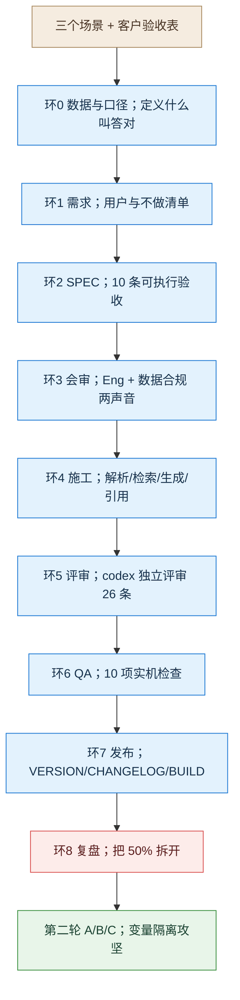

# RAG demo 八环讲解记录

> **用途**：课堂讲解用。本文不是复现手册——完整复现约 6 小时（含三轮评测），课堂上讲的是**流程与决策**。
> **读法**：每一环按同一结构讲四件事（输入 / 分析 / 决策与依据 / 门禁与产出），末尾附一句讲解要点。
> **与 R1 的差别**：R1 是确定性 CRUD 应用，本轮是 **AI 应用**。最关键的差别是——**"证据"从"测试全绿"换成了"固定评测集 + 多次运行统计"**，这一点在第 2 环和第 8 环各讲一次。
> **配套证据**：`ENVIRONMENT.md`（能力实测）、`evidence/`（21 份带时间戳证据）、`review.md`（codex 评审原文）、`eval/reports/`（评测报告）。

---

## 零、起点：不是一句话需求，是一张验收表

**这一轮的起点与 R1 不同。** R1 是一句话需求，本轮客户先给了一张表：

| 场景 | 任务范围 | 进阶验收指标 |
|---|---|---|
| 政企 RAG 问答 | 多份政策/制度文档、多轮记忆、原文溯源、解析入库、可视化 | 召回≥90%、准确≥85%、幻觉≤10%、单轮≤3s、溯源到段落 |
| NL2SQL 问数 | 建库、自然语言转 SQL、条件筛选、多表关联、统计图表 | 解析准确≥85%、≤3 表、自动纠错、≤2s、自动可视化 |
| 合同审查 | Word/PDF 上传、规则清单识别风险与缺失项、分级意见 | 核心风险召回≥88%、10 页≤10s、风险分级、结构化报告 |

**客户同时留了一列"需要确认的口径"**——这张表最重要的信息不是指标，而是**指标没定义**（召回按文档还是段落？幻觉按回答还是断言？延迟含不含检索？）。这直接决定了后面为什么要先做"环 0"。

**这一轮被追加了四条执行约束：**

| # | 约束 | 讲课时要强调的点 |
|---|---|---|
| 1 | 先做两条轴的研究（GStack 用法 / FDE 业界借鉴），再动代码 | 需求不清时，先补知识而不是先写代码 |
| 2 | 技术栈统一 Python + FastAPI + 轻前端；模型走本地 magpie；运行环境 Windows 本机 | 环境约束先定，否则后面对比全无意义 |
| 3 | **Lead 自主决策并在环边界自审**（用户授权） | 与 R1 的"环边界停下汇报"相反——但**必须留决策记录** |
| 4 | 有一个环专门定义"什么叫答对"（环 0） | 这是 AI 项目与 CRUD 项目最大的流程差异 |

---

## 一、八环全景（本轮为九环）

**各环产物（全部落盘，这是每环的"实物交付"）：**

| 环 | 产出文件 | 规模 |
|---|---|---|
| 0 数据与口径 | `docs/00-数据与口径.md` | 六项指标的可判定句 + 200/50 评测集规范 |
| 1 需求 | `docs/01-需求.md` | 4 类用户、7 条用户故事、7 条"不做" |
| 2 SPEC | `SPEC.md` | 10 条 AC + 4 类数据契约 |
| 3 会审 | `docs/03-会审记录.md` | 9 条发现、9 条义务 |
| 4 施工 | `src/`（7 模块）+ `web/` + `drafts` | 315 chunk、SSE 问答、双闸拒答 |
| 5 评审 | `review.md` + `docs/05-评审处置.md` | 26 条发现，逐条处置 |
| 6 QA | `qa-report.md` + `evidence/qa-ui-home.png` | 10 项实机检查、3 轮评测对照 |
| 7 发布 | `VERSION` 0.2.0.0 + `CHANGELOG.md` + `BUILD.md` | 2 个版本条目 |
| 8 复盘 | `retro.md` | 三个假象、债务清单、与研究的对照 |
| 第二轮 | `docs/07` / `08` / `09` + `eval/reports/EVAL-REPORT-v0.2.md` | 双口径、claim 指标、C 段 A/B |

**一个关于工时的真实数据**：环 0 到环 8 的"流程本身"约 3 小时，但**评测占了其中一半以上**（每轮 80 题的完整评测约 20 分钟，跑了 5 轮）。这与 R1 相反——R1 里最贵的是第 3 环四方评审，本轮最贵的是评测与复测。

---

## 二、环 0 数据与口径：先定义"什么叫答对"

### 输入
客户的验收表 + 三条待确认的口径问题。仓库是空的。

### 分析

这一环做了三件事，每件都挡掉了一个后患：

**第一件：把六项指标改写成可判定句。** 原话"召回≥90%"没有分母、没有测量方法。改写成：

> 在 200 条标注问答集上，**gold chunk（人工标注的相关段落）** 被 top-5 检索结果命中的比例 ≥90%

**第二件：算清样本量。** 5 个百分点的判定（85% vs 90%）需要 **n ≥ 200**——n=50 时 95% 置信区间半宽约 ±8.3pp，测了等于没测。这一条直接决定了评测集规模，也在第 8 环成为解释"为什么数字读不出来"的工具。

**第三件：识别出最大的测量陷阱。** 单跳/多跳题如果从条款反推生成，gold 就是出题依据的 chunk，**Recall@5 必然接近 100%，不能代表真实提问**。这个陷阱在环 6 真的发生了（100% 召回）。

### 决策与依据

| 决策点 | 选项 | 选择 | 依据 |
|---|---|---|---|
| 语料来源 | 客户脱敏文档 / 公开政策文件 / 合成制度库 | **公开 + 合成**（用户拍板） | 客户文档有审核周期，合成库能精确植入难例 |
| 扫描件 OCR | 纳入 / 不纳入 | **不纳入** | 解析质量不可控，会污染全部指标 |
| 延迟口径 | 单轮 ≤3s / TTFT + 流式 | **TTFT p95 + 流式完成 p95** | 实测按 MLPerf 交互档反推，3 秒只够约 50 个汉字 |

### 门禁与产出

- 四项（数据来源 / 合规边界 / 评测口径 / 集规模）全部有书面结论，才允许进环 1。
- 产出 `docs/00-数据与口径.md`；Q1 由用户拍板，Q2–Q4 采用建议默认并显式标注"可随时叫停"。

### 讲解要点
**"先定义答对，再写代码。"** 这一环不写一行程序，但它决定了后面每一环的判据。CRUD 项目可以跳过它，AI 项目跳过它就会在验收现场吵架。

---

## 三、环 1 需求：压缩版 office-hours

### 输入
客户验收表 + 环 0 的口径。

### 分析
标准 office-hours 是用 YC 式逼问把模糊需求问清。本轮需求已由客户给定，因此**只补三件客户没给的东西**：用户是谁、成功是什么样、明确不做什么。

产出 4 类角色（普通员工 / 新员工 / 制度管理员 / 审计合规）与 7 条带验收点的用户故事。

**一个关键判断**：这个场景的价值不在"答得快"，而在**"敢照着做"**——所以引用可定位与拒答，比流畅度重要。这条判断决定了环 2 把"引用校验"写成硬契约。

### 决策与依据

| 决策点 | 选择 | 依据 |
|---|---|---|
| 是否重跑完整 office-hours | **不重跑**（压缩） | 需求已明确，迭代方法论规定迭代从 spec 起步 |
| 多轮是否进验收 | **只演示不验收** | 多轮评测集成本高，收益低于单轮+拒答 |

### 门禁与产出
7 条用户故事全部带验收点；7 条"不做"写死（权限、OCR、版本管理、微调、离线、移动端、多轮验收）。

### 讲解要点
**需求的价值不在"多"，在"明确不做"。** 7 条 NOT in scope 是这一环最实用的产出。

---

## 四、环 2 SPEC：把验收写成可执行判定

### 输入
需求 + 环 0 口径。

### 分析
SPEC 写了 10 条 AC，每条必须映射到"测量方式 + 阈值 + 证据文件"。其中三条是 AI 项目特有的：

| 条款 | 为什么要写死 |
|---|---|
| **引用编号服务端校验** | 模型可能给出不存在的 `[c99]`，或把编号标在无关论断后。不校验 = 假引用 |
| **双闸拒答** | 只靠 prompt 时，"字面相似但语义无关"的 chunk 会诱导模型硬答 |
| **生成超时熔断** | 演示现场最怕卡死；15s 熔断后返回部分结果并标 `timed_out` |

同时定了四类数据契约：chunk 记录、索引元信息、SSE 事件序列、trace 字段。

### 决策与依据

| 决策点 | 选项 | 选择 | 依据 |
|---|---|---|---|
| 向量存储 | pgvector / Qdrant / FAISS / numpy | **numpy 内存索引** | 千级 chunk 暴力检索 <10ms；零服务依赖、Windows 友好、代码可读。替换点收敛在 `vector.py` |
| 切分单位 | 固定窗口 / 按段落 / 按条款 | **按"第X条"** | 条款是引用与验收的自然单位 |
| 前端 | React / Gradio / 静态单页 | **静态单页** | 课堂不引入构建链 |

### 门禁与产出
每条 AC 都有可执行测量方式；唯一例外（AC-02/AC-03 的最终值）显式标注"人工判定 + 判定人"。

### 讲解要点
**"可验收"不是形容词，是句式**：指标名 = 测量对象 + 口径 + 分母 + 测量方法 + 阈值。写不出这个句式，就等于没定义。

---

## 五、环 3 会审：两个声音，不跑四个

### 输入
SPEC + DECISIONS。

### 分析
按研究结论（单 demo 全跑四声音约占整轮 1/4 工时），本轮**只跑 Eng + 数据/合规**，Design/DX 留到 UI 阶段用清单代替。这是**明确裁剪**，不是遗漏，已登记在 DECISIONS §三。

两个声音提出 9 条发现，其中 4 条 High：

| 编号 | 发现 | 处置 |
|---|---|---|
| E-01 | SSE 契约没定义"生成超时"如何收尾，客户端会一直等 | `done` 事件加 `timed_out` / `partial` |
| E-02 | 流式输出无法在生成前校验引用，`sources` 与答案可能不一致 | 服务端在 `done` 时校验，非法引用置灰并记录 |
| C-01 | 嵌入/重排走公网，与"数据不出域"冲突，但 SPEC 没强制前端声明 | 页面固定合规横幅 |
| C-03 | 合成语料可能被误认为真实制度 | 文件首行注释 + 来源面板"示例文本"标记 |

### 决策与依据
9 条全部接收（无驳回），登记为 OB-01～OB-09，进入环 5/环 6 逐条关闭。

### 门禁与产出
放行进入施工。产出 `docs/03-会审记录.md`。

### 讲解要点
**会审的价值在于"提前发现契约漏洞"**。E-02 这种"流式与校验时序冲突"的问题，只有真的走一遍流程才会被想到。

---

## 六、环 4 施工：按规格做，遇到歧义先取证

### 输入
SPEC（含数据契约）+ DECISIONS。

### 分析
施工分三层：解析切分 → 混合检索 → 生成与引用。每一层都先跑通最小闭环，再接下一层。

**第一个真实歧义（Confusion Protocol）**：A1 场景（采购审批额度 500 万 vs 300 万）里，"旧条款已废止"的声明藏在**另一份文件的附则**第二十六条。语义检索召不回来——因为"废止"与"谁审议"语义距离远。

处置不是调参，而是加一个**确定性探针**：对已选中文档做正则扫描，把含"废止/失效/试行期/过渡期"的条款补进上下文（限 2 条，仅在决定作答时并入）。

**实测效果（同一问题，前后对比）：**

| | 答案 |
|---|---|
| 加探针前 | "结论：500 万元以上…应提交总经理办公会审议。[c01]"（未提旧条款状态） |
| 加探针后 | "…第十二条原规定 300 万元以上需提交总经理办公会审议，但该条关于采购审批权限的规定已于 2025 年 3 月 1 日被实施细则废止；其他条款继续有效。" |

**检索实测数据（施工期第一次跑通）：**

| 问题 | top1 分数 | 关键命中 |
|---|---|---|
| 500 万以上谁审议 | 0.9978（2025 细则第十条） | 2023 办法第十二条仍在 #4（0.971）——正好构成冲突场景 |
| 履约保证金何时退 | 0.7836（第十九条） | — |
| 员工婚假多少天（库内没有） | **0.0003** | 与拒答阈值 0.30 差三个数量级 |

### 决策与依据

| 决策点 | 选项 | 选择 | 依据 |
|---|---|---|---|
| 上下文长度 | 全文入 prompt / 截断 | **每条截 500 字** | 缩短 prompt 争取首字延迟；引用仍指向完整 chunk |
| 拒答阈值 | 0.1 / 0.3 / 0.5 | **0.30** | 有答案题 top1 多在 0.78+，无答案题 0.0003，0.30 有充分余量 |
| 探针是否总并入 | 总是 / 仅作答时 | **仅作答时** | 否则无答案问题会被一堆无关"废止"条款污染上下文 |

### 门禁与产出
施工环**没有自动门禁**（GStack 里施工本就是唯一无技能的一环），靠环 5/环 6 事后抓。产出 `src/` 七个模块、`web/index.html`、315 个 chunk 的索引。

### 讲解要点
**"能落地的歧义处置，往往是确定性的那一步。"** 加一条正则，比调 embedding、换模型都有效——因为它补的是"检索架构的盲区"，不是"模型能力不足"。

---

## 七、环 5 评审：codex 独立评审 26 条

### 输入
`src/` 全部代码 + SPEC + DECISIONS + `eval/`。

### 分析
评审方是 **codex CLI**（`opencode-go/deepseek-v4.1-flash`，effort=medium），与实现主控**不同进程、不同上下文**。共出 26 条：**Critical 1、High 14、Medium 10、Low 1**。

**Critical 那一条，是整个项目最值钱的发现：**

> `# 标题` 被当成正文块的第一个 block → 元数据解析分支（`if m and not blocks`）永不执行 → **327 个 chunk 的 `status`、`effective_date` 全为空**，标题块还被选进出题池（14 个 gold 指向它）。

**为什么自测发现不了**：当时的自测指标是"召回 91.67%、引用 100%、拒答 100%"——链路全绿。**坏的不是链路，是数据。** 而"生效日期/是否废止"恰恰是政企问答最需要的东西。

修复后：315 chunk，**缺失元数据 0 条、空条款号 0 条**；A2 问题也从"材料未提供生效日期"变成能正常比较两个日期。

**其余高危项（修复 10 条）：**

| 编号 | 问题 | 修法 |
|---|---|---|
| F02 | rerank 失败降级返回 RRF 分数（量纲 ~0.03），与阈值 0.30 冲突 → 全部拒答 | 归一化到 [0,1]×0.55 |
| F08 | `/api/trace/{id}` 可用 `..%5C..` 穿越读任意 JSON | 白名单正则 + 400 |
| F09 | trace_id 用毫秒时间戳，并发互相覆盖 | UUID |
| F10 | 嵌入返回数量异常时静默错位 | 数量/缺失/一致性三重校验 |
| F12 | 正确率分母排除拒答，未测项仍可输出 PASS | 新分母 + INCOMPLETE |
| F13 | judge 失败被算成"忠实" | 仅有效判定计入 |
| F15 | BM25 空 token 把前 30 个任意 chunk 注入 RRF | 空候选 |

### 决策与依据
按"会导致错误验收 / 数据泄露 / 演示翻车"排序修：Critical 全修，High 修 10 条、部分修 1 条、**如实登记 3 条未修**（F05 引用语义校验、F14 总 deadline、F06 完整指代消解）。未修项全部进 `docs/05-评审处置.md` 的 R-* 清单。

### 门禁与产出
10 项 QA 中的 3 项专门做回归（F08/F09/F20）。产出 `review.md`（336 行）+ 处置表。

### 讲解要点
**"独立复核不是形式，是唯一能抓出'数据坏了但链路活着'的手段。"** 主控自测 91.7% 召回时，系统其实一条时效信息都没有。

---

## 八、环 6 QA：10 项实机检查与三次翻车

### 输入
可运行系统（`http://127.0.0.1:4180`）。

### 分析
`scripts/qa_checks.py` 跑了 10 项，全过：健康检查、无答案拒答（658ms 且不调模型）、版本冲突处理、同文件数字冲突、引用有效、多轮指代、路径穿越拦截（400）、trace 字段完整、空问题拦截（400）、并发 trace 唯一。

但 QA 阶段真正暴露的是**评测工具自身的问题**，而且翻了三次车：

| 轮次 | 现象 | 根因 | 修法 |
|---|---|---|---|
| 第 1 次 | 正确率 50%，42.5% 判定失败 | judge `max_tokens=800` 被 deepseek 思维链（约 450 token）吃光，JSON 截断 | 提到 2500，同批 12 条重测 12/12 成功 |
| 第 2 次 | claim 支撑率恒为 0 | 按句号切分会把 `[c01]` 切到下一段，论断正文为空 | 改为"以引用为锚点回看前文" |
| 第 3 次 | 正确率 43.75%，judge 失败反而升到 42.5% | 重试把 effort 提到 high，思维链更长，截断更多 | 先修配额再谈重试 |

### 决策与依据

| 决策点 | 选择 | 依据 |
|---|---|---|
| 全量 208 条带 judge | **否** | 实测 19 秒/条，全量需 60 分钟以上；改"全量无 judge + 80 条分层子集带 judge" |
| 迟延门禁是否下调 | **否** | 实测 TTFT p95 4.0–4.8s，仍按 SPEC 的 ≤1s 记 FAIL（DECISIONS D-16） |

### 门禁与产出
功能 10/10 通过；指标：Recall 100%（**注明题料同源**）、引用 100%、拒答 100%、误拒 1.25–3.75%、Faithfulness 62–80%、TTFT p95 2.9–4.8s。产出 `qa-report.md` + 界面截图。

### 讲解要点
**"评测工具本身也要被评测。"** 42.5% 的判定失败会把任何结论搅成噪声——而它不写在代码里，只写在配置里。

---

## 九、环 7 发布：发布 ≠ 达标

### 输入
全绿功能 + 不达标的指标。

### 分析
`ship` 的标准动作是：版本递增、CHANGELOG、文档同步、发布门禁。本轮**没有远端可推**（本地 demo），因此如实记录不可用项，而不是假装发布成功。

### 决策与依据

| 决策点 | 选择 | 依据 |
|---|---|---|
| 是否等指标达标再发版 | **不等** | 发的是"可演示、可评测的版本"，不是"通过验收的版本"，两者必须在文档上分开 |
| 版本号 | 0.1.0.0（首版）→ 0.2.0.0（攻坚） | 四段式，与课程约定一致 |

### 门禁与产出
`VERSION` 0.2.0.0、`CHANGELOG.md`（两版条目，Known issues 单列）、`BUILD.md`（四步启动 + 故障表 + 降级边界）。

### 讲解要点
**发布门禁拦的是"不完整"，不是"不达标"。** 把"未达标"写进 Known issues，比改门禁诚实得多。

---

## 十、环 8 复盘：把 50% 拆开

### 输入
五轮评测数据 + 21 份证据。

### 分析
复盘没有停在"模型不行"，而是拆成三类：

| 类型 | 占比 | 判据 |
|---|---|---|
| **评测口径过严** | 约一半 | judge 拿整条条款当标准答案，要求覆盖每个并列细节 |
| 多跳只答一半 | 约 1/4 | 两段式问题只答后一段 |
| 无依据的时效推断 | 约 1/4 | 补写"试行期两年"这类材料没写的结论 |

同时记录**三个假象**：Recall 100% 是题料同源；拒答 100% 部分来自阈值差三个数量级；引用可定位 100% 只证明编号合法（F05 未修）。

### 决策与依据
把"让数字变真"与"让系统变好"分成两件事，直接引出第二轮的三阶段设计。

### 讲解要点
**"复盘的价值不是总结，是把一个坏数字拆成可分别验证的几个原因。"**

---

## 十一、第二轮：变量隔离攻坚（A / B / C）

> 这一轮不在原始八环内，是**迭代轮**（按迭代方法论：从 spec 起步，跳过 office-hours）。

### A 段：直接修（prompt + judge 结构化）

| 改动 | 依据 |
|---|---|
| 复合问题必须逐子问题作答 | 复盘显示 1/4 失败是多跳只答一半 |
| 不得推断材料未写明的时效 | 复盘显示 1/4 失败是无依据时效推断 |
| judge 增 `missing_facts` 并强制字段齐全 | 让"缺哪条"可见，而不是一个模糊的 partial |

**同集合 before/after：Faithfulness 62.34% → 79.75%（+17.4pp）**，误拒 3.75% → 1.25%。**正确率没动**（42.5% → 40%，噪声内）——这成为 B 段的直接依据：瓶颈在尺子。

### B 段：口径重做（走轻量 spec + 两声音会审）

| 变更 | 结果 |
|---|---|
| AC-02 改"最小事实点覆盖"（每题 1–4 条 facts） | 正确率 40.00% → **50.65%**（+10.65pp，**全部来自尺子**） |
| 冲突/时效 8 条改人工判定 | 5 correct / 2 partial / 1 wrong = 62.5%，理由逐条落盘 |
| 新增 claim 级引用校验（3-gram，下限指标） | 78.06% |
| 新增 judge 失败率门禁（≤2%，超限判 INCOMPLETE） | 实测 2.53% → **结论 INCOMPLETE**，不给 PASS/FAIL |

**这一轮最重要的产出不是 50.65%，而是"INCOMPLETE"这个结论。** 它说明评测本身还没稳到可以下判断。

### C 段：模型 A/B（只记证据，不动主线）

| 对比 | 结果 | 结论 |
|---|---|---|
| 生成 provider（4 题 × 5 模型） | luna 4636ms < sol 6008 < deepseek 7023 < glm 7633 < kimi 8688 | 维持 luna |
| 嵌入（20 条人工无偏题） | Qwen3-4B / 8B / bge-m3 **均 100% doc 召回** | **基准无区分度**，无法据数据选型 |

### 讲解要点
**"一次只改一个变量。"** 如果同时改 prompt 和尺子，那 17.4pp 与 10.65pp 就永远分不清是谁的功劳。

---

## 十二、全程决策分工汇总

| 决策 | 谁定 | 性质 |
|---|---|---|
| 语料来源（公开 + 合成） | **用户** | 范围/合规 |
| 技术栈、端口、模型选型 | Lead | 技术 |
| 延迟口径改 TTFT + 流式 | Lead（有实测依据） | 测量方法 |
| 拒答阈值 0.30、探针策略 | Lead | 算法 |
| 评测口径改 facts | **Lead 提案 + 用户授权范围内执行，客户侧待确认** | 验收标准（本应人拍板） |
| 多跳是否退出验收 | **待用户拍板** | 范围 |
| 指标未达标是否下调门禁 | **决定不下调** | 纪律 |

**一句总结：技术决策 AI 自决，验收与范围决策必须人拍板。** 本轮唯一"越界嫌疑"是 facts 口径——所以它被做成"双报 + 不可跨口径比较 + 明确待客户确认"。

---

## 十三、这一轮留下的诚实清单

**未修（已登记）：**
- F05 引用只校验编号存在，不校验该 chunk 是否支持论断（claim 校验是 3-gram 下限近似）
- F14 15s 是单次读超时，不是整体 deadline
- F06 多轮只做启发式改写，非真正指代消解
- R-29 `refused` 误标：答案开头含"资料不足"会被记为拒答（h-07 受影响）

**未验证：**
- 断网、空索引两种异常场景**未做实机演练**（只有代码路径）
- 客户抽检 20% 未进行，冲突题判定为**自评**
- `facts` 由 LLM 抽取，人工抽检 20% 未留记录

**明确不承诺：**
- 完全离线 / 数据不出域（magpie 上游仍是云端 provider）
- 扫描件 OCR
- 多轮质量
- TTFT ≤1s（差一个数量级，需专用推理环境）

---

## 十四、一页话总结

**这套流程先让我做出一个"召回 91.7%、引用 100%"的系统，再用独立评审告诉我它的元数据全是空的、用分层评测告诉我它正确率只有 50%、用三轮对照告诉我其中一半是尺子和测量工具的问题。**

**R1 教的是"门禁会拦人"；这一轮教的是"指标会骗人"**——包括骗人的方式不止一种：题料同源会让召回虚高，整条条款当 gold 会让正确答案判半对，judge 配额不足会让 42% 的判定悄悄失败。

---

## 附录 A：关键数据一览

| 项 | 数值 | 来源 |
|---|---|---|
| 语料 | 12 份合成制度 / 315 chunk / 2560 维 | `data/index/meta.json` |
| 评测集 | 主集 208（120 单跳 / 48 多跳 / 8 冲突 / 32 无关）+ 拒答 50 | `eval/golden_manifest.json` |
| 子集 | 80 条（8 冲突 / 42 单跳 / 30 多跳） | `eval/subset_judged.jsonl` |
| 检索延迟 | 571ms（嵌入+检索+重排） | `data/traces/` |
| 生成首字 | p50 1595ms / p95 2658ms | 同上 |
| Recall@5 | 100%（**题料同源**）；异源冒烟 91.67% | `evidence/eval-*.json` |
| Faithfulness | 62.34% → 79.75%（A 段） | 同上 |
| 正确率 | 40.00%（旧口径）→ 50.65%（facts 口径） | 同上 |
| claim 支撑率 | 78.06% | `EVAL-REPORT-v0.2.md` |
| judge 失败率 | 42.5% → 7.5% → 2.53% | 三轮对照 |
| QA | 10/10 | `evidence/qa-20261020-095912.json` |
| 评审 | 26 条（1 Critical / 14 High），修 22 条 | `review.md` |

## 附录 B：证据索引（讲课时可现场打开）

| 要证明的事 | 打开这个 |
|---|---|
| 门禁/指标是不是真的 | `eval/reports/EVAL-REPORT.md`、`EVAL-REPORT-v0.2.md` |
| 评审是不是真的独立 | `review.md`（含 codex 实测命令与发现） |
| 修没修 | `docs/05-评审处置.md`（逐条 修/部分修/未修） |
| 决策有没有依据 | `DECISIONS.md`（D-01～D-22，含 Rejected 列） |
| 界面长什么样 | `evidence/qa-ui-home.png` |
| 环境能不能跑 | `ENVIRONMENT.md`（含三套 GStack 版本偏差） |
