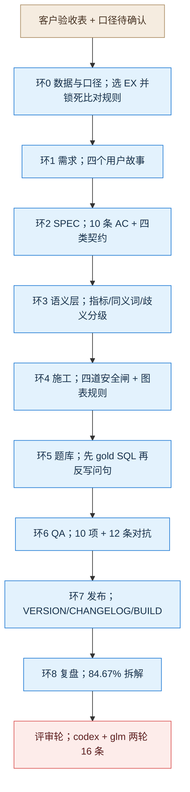

# NL2SQL demo 八环讲解记录

> **用途**：课堂讲解用。本文不是复现手册（复现见 [11-操作手册.md](11-操作手册.md)），讲的是**流程与决策**。
> **读法**：每环按同一结构讲四件事（输入 / 分析 / 决策与依据 / 门禁与产出），末尾一句讲解要点。
> **与 ① 的差别**：① 的证据是"拒答与引用"，② 的证据是**可执行的标准结果集**——所以 ② 能说"判定可信"，而 ① 只能说"测量受限"。
> **配套**：`SPEC.md`、`DECISIONS.md`（18 条决策 + 口径澄清）、`review.md`（codex + glm 两轮评审）、`qa-report.md`、`retro.md`。

---

## 零、起点：客户验收表 + 一个必须先回答的问题

客户给的第 2 组指标是：**解析准确 ≥85%、≤3 表、自动纠错、≤2s、自动可视化**。

这句话里有 5 个未定义项，最要命的是第一个：

> **"解析准确"到底指什么？** 是 SQL 文本与标准 SQL 一致（EM），还是**执行结果一致（EX）**？

**这一轮的全部设计都建立在这个选择上：选 EX。**

| 选 EM（文本一致） | 选 EX（结果一致） |
|---|---|
| 一条正确 SQL 换个 JOIN 顺序就判错 | 多解 SQL 都接受 |
| 必须有参考答案文本 | 只需标准结果集 |
| 仍要人工判定 | **完全自动，零 judge** |

选 EX 的连带收益：**绕开了 ① 最大的坑（judge 不稳定）**。① 的 judge 失败率曾 42%，结论不可读；② 从设计上就不需要 judge。

---

## 一、八环全景（本轮为九环）

**各环产物：**

| 环 | 产出 | 规模 |
|---|---|---|
| 0 | `docs/00-数据与口径.md` | EX 八条比对规则 + 150/15/20 分层 |
| 1 | `docs/01-需求.md` | 4 类用户、8 条用户故事、不做清单 |
| 2 | `SPEC.md` | 10 条 AC、四类契约、四道闸顺序 |
| 3 | `semantic_layer.json` | 14 指标 + 23 同义词 + 7 关联 + 6 类歧义 |
| 4 | `src/`（7 模块）+ `web/index.html` | 6 表 8,584 行、四道闸、图表规则表 |
| 5 | `eval/golden_set.jsonl` 等 4 份 | 150 + 15 + 20 题，全部可执行 |
| 6 | `evidence/qa-*.json`、`safety.json` | QA 10/10、对抗 12/12 |
| 7 | `VERSION` / `CHANGELOG.md` / `BUILD.md` | v1.0.0.0 |
| 8 | `retro.md` | 四个教训、11 条债务 |
| 评审 | `review.md` + `evidence/review-*.md` | 16 条发现，真问题 14 条 |

---

## 二、环 0 数据与口径：先定尺子，再定数据

### 输入
客户验收表 + 三条口径疑问。

### 分析
三件事：

1. **选 EX 并写死比对规则**（列数一致；列名/列序/行序无关；浮点容差 0.01；空集=空集；多解都接受；**行序仅题面要求排序时校验**）。
2. **算样本量**：150 题时 5pp 判定足够；EX 不需要抽样（全自动），所以比 ① 省题。
3. **识别测量陷阱**：如果 gold SQL 带 `LIMIT` 却没有 `ORDER BY`，"前 N 条"根本不可判定——这条后来真的炸了（见环 5）。

### 决策与依据

| 决策 | 选择 | 依据 |
|---|---|---|
| 判定方式 | **EX 全自动** | 结果可执行 → 不需要 judge → 绕开 ① 的测量不可信问题 |
| 数据来源 | **自建合成库** | 公开集许可未核实；客户库涉敏；只有自建能保证"标准 SQL 结果=唯一答案" |
| 规模 | 6 表 8,584 行 | 够覆盖 6 类题型，不引入无谓性能问题 |

### 门禁与产出
库结构、埋点、EX 规则、题型分桶、语义层定义五项有书面结论才进环 1；`verify_db` 11 项断言全 PASS 才允许评测。

### 讲解要点
**"先定义什么叫答对——在 AI 项目里，这一步决定了后面能不能下结论。"**

---

## 三、环 4 施工（提前）：四道闸先落地，再谈问数

> 说明：② 的施工顺序与 ① 不同——**先做安全闸，再做功能**。原因：NL2SQL 会生成可执行代码，闸门晚一天做，就多一天"能跑但不能演示"。

### 输入
SPEC 的安全契约 + 语义层。

### 分析
四个闸，全部确定性：

| 闸 | 实现 | 为什么不能靠提示词 |
|---|---|---|
| 只读 | 连接串 `mode=ro` | 提示词可被绕过，文件权限不会 |
| 表白名单 | SQLite `set_authorizer`（**默认拒绝 + 函数白名单**） | 运行时拦截比静态正则可靠 |
| 强制 LIMIT | 外层包 `SELECT * FROM (...) LIMIT 1001`（取 +1 判截断） | 防全表扫描拖死进程 |
| 超时 | `set_progress_handler` 计数中断 | SQLite 无原生超时 |

**第五道是后来加的：意图闸。** 实测"帮我删掉2026年1月的账单"会被模型解释成"查询 1 月账单"并**正常返回数据**——用户会以为删了。这不是安全漏洞（写不进去），是**沟通事故**，所以必须显式拒绝。

### 决策与依据
- **不做 schema 检索**：6 表 ~1.5k token，全量入 prompt 更稳，少一个故障点（>30 表再考虑）。
- **图表用规则表**，不交给模型：可解释、可测试、零延迟。
- **歧义分两级**：blocking（营收/近三月，无默认口径）与 advisory（在网/月费/SLA，有默认口径）。全阻塞会堵掉近 1/5 正常问题。

### 门禁与产出
对抗测试 12/12（12 类攻击全拦）；`qa_checks` 10/10。

### 讲解要点
**"凡是能确定性判的，绝不交给模型；而确定性闸也会误伤，所以闸要分级。"**

---

## 四、环 5 题库：先有答案，再有问题

### 输入
语义层 + 六个题型桶。

### 分析
**顺序反过来**：先写 gold SQL → 执行得标准结果集 → 再让 LLM 反写自然问句。

好处：问题与答案不可能错位。RAG 那轮的"题料同源"在这里影响小得多——**结果集是执行出来的，骗不了人**。

### 决策与依据

| 决策 | 选择 | 依据 |
|---|---|---|
| 题量 | 150（40/30/20/30/15/15） | 配额断言，少一条就报错 |
| 反写问句 | LLM 批量 10 条/次 | 15 次调用完成 |
| 锚点集 | **20 条人工写** | 校准自动判定（最终 100% 一致，证明 EX 可信） |
| 歧义集 | 15 条人工写 | 考"该反问而不是硬答" |

### 门禁与产出
配额断言 + 每条 SQL 必须可执行；锚点集 20 条全部可执行。

**这里踩了本轮最贵的一个坑：** 题库不公平会被误认为模型能力差。

| 缺陷 | 表现 | 修法 |
|---|---|---|
| gold 带 `LIMIT 20`，题面没说 | 模型返回 35 行判错 | 有 LIMIT 必须有 ORDER BY，否则去 LIMIT |
| gold 输出 3 列，题面只问 1 列 | 模型"合理地"给 2 列判错 | 题面必须点名每一列 |
| 模板自带 `ORDER BY`，题面没排序要求 | 顺序不同判错 | 只有题面要求排序才校验 |
| 意图闸含"新增" | "新增订单数"被拒（4 条） | 收紧动词表 |
| 营收歧义含"金额" | "月费金额"被阻塞 | 触发词收窄 |

### 讲解要点
**"在 NL2SQL 里，'题库不公平'比'模型答错'更隐蔽——因为判错时看起来完全像模型的问题。"**

---

## 五、环 6 QA：功能全绿，但指标不过

### 输入
可运行服务 + 150 题。

### 分析

| 类别 | 结果 |
|---|---|
| 功能 QA | **10/10** |
| 安全对抗 | **12/12** |
| 主集 EX | **84.67%（127/150，修复前 80.67%）** |
| 可执行率 | **100%** |
| 锚点一致 | **100%（20/20）** |
| 歧义反问 | **80%（12/15）** |
| 延迟 p50/p95 | 2660ms / **15644ms** |

**分桶（当时口径）：** 单表 87.5%、两表 56.7%、三表 70%、聚合 93.3%、时间 86.7%、空值 93.3%。
> codex 评审修正评测器后：单表 97.5%、两表 63.3%、三表 75.0%、聚合 86.7%、时间 93.3%、空值 93.3%，总分 84.67%。

**JOIN 桶是真实短板**：模型会用 `product_name` 关联同名产品、忘记对重复客户去重——而这正是我埋的 A/C 两类雷。

### 决策与依据
- **不下调阈值**（EX 仍按 85% 记 FAIL）。
- **延迟归因于环境**：执行层 0–3ms，瓶颈是模型首 token 排队（与 ① 同一天花板）。

### 讲解要点
**"功能全绿 + 可执行 100% + 锚点 100%，这个组合才让 84.67% 成为可读的数字。"**

---

## 六、环 7 发布：发的是可演示版本

### 输入
功能全绿、指标部分不达标。

### 分析
`VERSION` 1.0.0.0、`CHANGELOG`（Results 与 Known issues 分列）、`BUILD`（四步启动 + 7 条故障表）。

### 决策与依据
发布不等达标；**"未达标"写进 Known issues，而不是调门禁**。

### 讲解要点
**"发布门禁拦的是不完整，不是不达标。"**

---

## 七、环 8 复盘：把 84.67% 拆开

### 分析
29 条失败分四类：列数不同 13、行数不同 10、顺序/内容 3、结果集 2、值不同 1。**其中 9 条已确认是我的题库/闸门缺陷**，修完 EX 从 76.7% → 80.67%（此数为 codex 评审前口径；评测器修正后为 **84.67%**）。

### 决策与依据
把"让数字变真"和"让系统变好"分开——所以先修题库、再谈模型。

### 讲解要点
**"复盘的价值不是解释失败，而是判断这条失败该由谁负责。"**

---

## 八、评审轮：两轮、16 条

| 轮次 | 评审方 | 方式 | 发现 |
|---|---|---|---|
| 1 | glm-5.3（不同家族） | 1600 字符分片 + 多模型回退 | 16 条（真问题 14、误报 2） |
| 2 | **codex**（本机 `codex exec`） | 沙箱内自主读文件 | 见 `review.md` |

**已修的 6 条（第 1 轮）：** authorizer 改默认拒绝 + 函数白名单、`truncated` 精确判定、trace_id 校验、`complete_statement` 纵深防御、输入钳制、错误脱敏。修完回归：安全 12/12、QA 10/10、EX 不变。

**最重要的一个发现是评审方式本身：** 一次性把 3–6 万字符送进模型会返回 **HTTP 200 + 空内容**（deepseek/sol 在 ~1.5k 字符即空）。这与 ① 的 judge 截断同类：**模型"没说话"时，管道会当成"没意见"。**

### 讲解要点
**"评审不是走流程，它唯一的价值是抓到'自测看不见'的那类问题。"**

---

## 九、决策分工汇总

| 决策 | 谁定 |
|---|---|
| 判定口径（EX 而非 EM） | Lead（有统计依据） |
| 数据来源（自建合成库） | **用户拍板** |
| 业务域（政企专线+工单+账单） | **用户拍板** |
| 四道闸与分级歧义 | Lead |
| 指标未达标不下调阈值 | Lead（纪律） |
| 是否接受 codex 替代方案 | **待用户确认** |

---

## 十、诚实清单

**未达标：** EX 84.67%（阈值 85%）、JOIN 68%；单表 97.5% 已达标；延迟 p95 5244ms（环境依赖）。
**未修：** 15 条债务（R2-01～R2-16），含复杂窗口函数、多轮、歧义词表硬编码、`ORDER BY+LIMIT` 无 tiebreaker。
**未验证：** 客户抽检 20%、真实语料替换。
**口径澄清：** "AST 白名单"实为静态正则 + authorizer 运行时强制；独立评审第一轮非沙箱。

---

## 十一、一页话总结

**① 教的是"系统会不会承认不知道"；② 教的是"系统的对错能不能被机器判定"。**

② 最有价值的产出不是 84.67%，而是这个组合：**可执行 100% + 锚点 100% + 判定零 judge**——它证明"自动验收"这条路在结构化数据上是通的。剩下的 19.33% 是真实能力缺口，其中 JOIN 一项占了 18 条。
